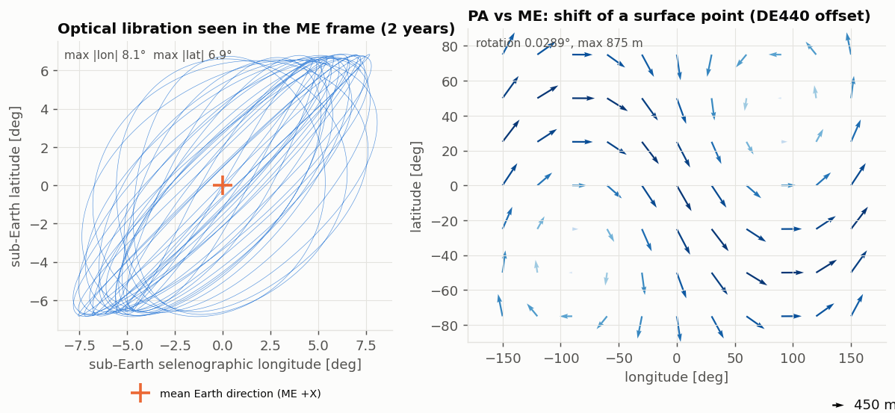
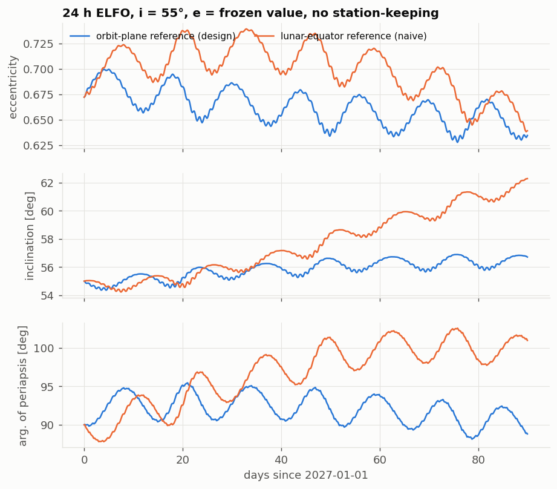
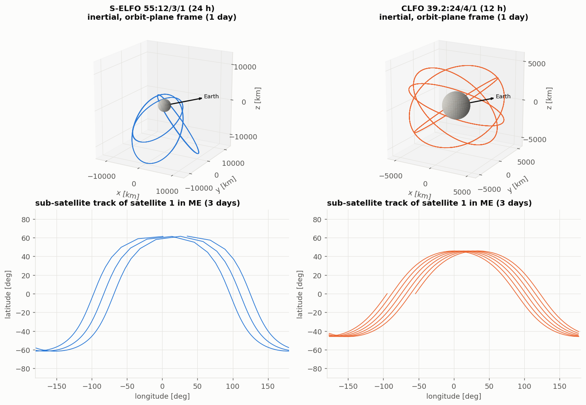
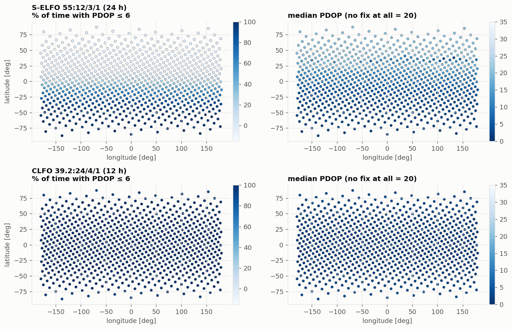
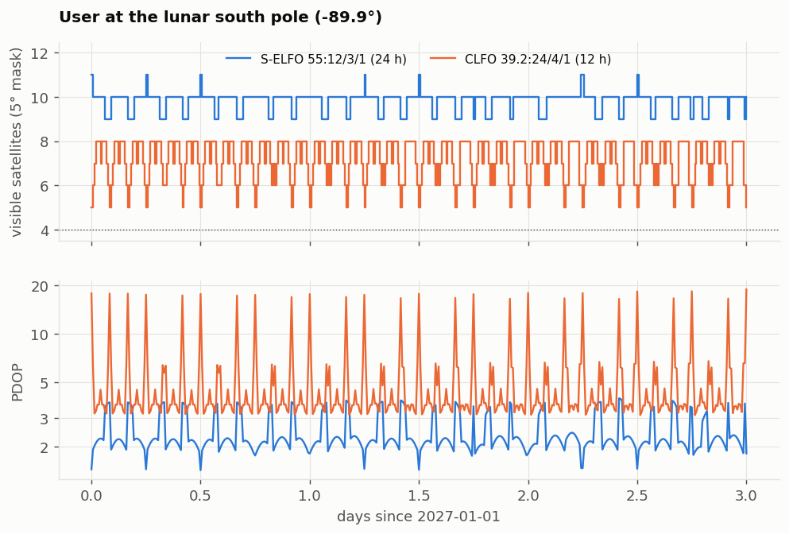

# lunarnav: lunar reference frames and a GNSS-like constellation around the Moon

A small, self-contained Python simulation of three things that sit at the base of lunar
navigation:

1. **Lunar reference frames**: the inertial Moon-centred frame, the **Mean Earth / Polar
   Axis (ME)** body-fixed frame, and the **Principal Axis (PA)** frame, and the ~875 m
   difference between the last two.
2. **Cislunar orbit dynamics**: propagation in a lunar spherical-harmonic field with Earth
   and Sun third-body terms, and the **frozen elliptical orbits (ELFO)** used to serve the
   south pole.
3. **A lunar GNSS**: Walker constellations of navigation satellites, visibility from the
   lunar surface, DOP, and single-point pseudorange solutions.

Everything is built from public literature and public constants (sources below). It is a
teaching/demonstration code, not a flight or mission-analysis tool; see
[Limitations](#limitations).



## Quick start

```bash
pip install -e ".[dev]"
pytest                                  # 32 tests (4 need SPICE kernels, else skipped)
PYTHONPATH=. python scripts/run_demo.py --quick    # ~1 min, 7 days, 200 users
PYTHONPATH=. python scripts/run_demo.py            # ~4 min, 28 days, 800 users
```

The demo regenerates every figure in `docs/figures/` and the tables in
[`docs/results.md`](docs/results.md).

## The frames

| Frame | Axes | Used for |
|---|---|---|
| **MCI** (ICRF-aligned, Moon-centred) | ICRF axes, origin at the Moon's centre | orbit propagation |
| **ME**: Mean Earth / Polar Axis | +Z mean rotation axis, prime meridian through the mean Earth direction | cartography, selenographic lat/lon, user positions |
| **PA**: Principal Axis | axes of the Moon's principal moments of inertia | gravity field (so C21 = S21 = S22 = 0) |
| **Orbit-plane** (inertial) | +Z normal to the mean Earth-Moon orbit plane | orbit elements for frozen-orbit design |

* **ME** is realised with the IAU 2009 trigonometric series (pole RA/Dec and prime meridian,
  13 libration arguments), the same model NAIF ships as `IAU_MOON`. Its prime meridian is
  the *mean* Earth direction, so the Earth librates around it. The test suite checks this:
  over 19 years the sub-Earth point has mean ≈ (0°, 0°), with longitude and latitude
  libration bounded to ±7-8.6° and ±6-7.4° (the plot above, 2 years, reaches ±8.1° and ±6.9°),
  the textbook optical-libration envelope.
* **PA** differs from ME by a *constant* rotation. I use NAIF's `MOON_ME_DE440_ME421`
  angles (67.8526″, 78.6944″, 0.2785″). The resulting rotation is 0.02886° and the
  surface shift is 875 m, both matching what NAIF states for DE440. The right panel above
  shows that shift as a vector field: a coordinate pair read in the wrong frame lands up
  to ~875 m away.
* The IAU series is lower accuracy than the numerically integrated DE440 libration. Measured
  against SPICE over 19 years: 145 m worst case, 82 m RMS (see [SPICE cross-check](#spice-cross-check)).

## Dynamics and the frozen-orbit result

Force model (all in `lunarnav/gravity.py`, `lunarnav/propagate.py`):

* Lunar gravity to degree 3 in the **PA** frame (unnormalised Cunningham recursion), with
  GRAIL-era `GM = 4902.8001 km³/s²`, `R = 1738 km`, `J2 = 203.3e-6`, `C22 = 22.4e-6`.
* Earth and Sun third-body (direct + indirect terms) from analytic ephemerides.
* DOP853 integrator, `rtol = 1e-11`.

**Frozen orbits.** Published ELFO designs fix eccentricity from `e² + (5/3)cos²i = 1`. That
relation is the Earth third-body (Kozai) result, so it only works if inclination is
measured from the **Earth-Moon orbit plane**, not the lunar equator. The demo propagates the
same orbit (24 h, i = 55°, e = 0.672, ω = 90°) both ways for 90 days with no station-keeping:



| inclination measured from | e range | i range | ω drift |
|---|---|---|---|
| Earth-Moon orbit plane (correct) | 0.628-0.699 | 54.4-56.9° | −0.026°/day |
| lunar equator (naive) | 0.638-0.739 | 54.2-62.3° | +0.133°/day |

## The constellations

Two example designs from the public LANS constellation trade study
([arXiv:2510.16030](https://arxiv.org/abs/2510.16030)), not any operator's baseline:

* **S-ELFO 55°: 12/3/1**, 24 h period, frozen e = 0.672, ω = 90° (apolune over the south).
* **CLFO 39.2°: 24/4/1**, circular, 12 h period.



Performance over 28 days with a 5° elevation mask (full table in
[`docs/results.md`](docs/results.md)):

| | S-ELFO (12 sats) | CLFO (24 sats) |
|---|---|---|
| South pole: 4+ satellites in view | 100 % | 100 % |
| South pole: PDOP ≤ 6 | 100 % | 82.5 % |
| South pole: median PDOP | 2.2 | 3.8 |
| Global: PDOP ≤ 6 | 40.1 % | 99.5 % |
| Global: median PDOP | 4.1 | 1.9 |
| North pole: 4+ satellites | 0 % | 100 % |

The ELFO constellation concentrates service at the south pole with half as many satellites
and gives essentially nothing at the north pole, while the circular constellation is global
but weaker at the poles. This agrees qualitatively with the published conclusions (12 S-ELFO
satellites for 4-fold south-pole coverage; ≥ 20 CLFO satellites for global PDOP ≤ 6). That
is a sanity check, **not** a reproduction of their numbers: different force model,
sampling, and design parameters.




## How the code is checked

| Check | Against | Test |
|---|---|---|
| Lunar and solar ephemerides | Meeus *Astronomical Algorithms* worked examples 47.a and 25.a | `test_ephemeris.py` |
| Frame + ephemeris together | known libration envelope and mean-Earth direction | `test_frames.py` |
| IAU orientation constants and rates | values read from NAIF `pck00011.tpc` (per-century) vs IAU report (per-day) | `test_frames.py` |
| PA/ME offset magnitude | NAIF: 0.02886°, ~875 m | `test_frames.py` |
| PA→ME matrix, IAU series, Moon ephemeris | SPICE with DE440 kernels (optional) | `test_spice.py` |
| Spherical-harmonic acceleration | closed-form J2; finite difference of an independent Legendre-based potential (degree 3) | `test_gravity.py` |
| Propagator + frames | two-body closure/energy; J2 nodal and apsidal rates vs analytic theory (agree to 0.05 %) | `test_orbits.py` |
| Frozen orbit | bounded e, i, ω over 60 days | `test_orbits.py` |
| DOP | closed form for a symmetric 4-satellite geometry (HDOP, VDOP, TDOP) | `test_gnss.py` |
| Position solver | noise-free recovery to 1e-9 km; Monte-Carlo RMS = PDOP·σ within 5 % | `test_gnss.py` |

## SPICE cross-check

`scripts/spice_crosscheck.py` compares everything above to NAIF SPICE (DE440s, `moon_pa_de440`,
`moon_de440_250416.tf`, `pck00011.tpc`, `naif0012.tls`; ~45 MB, downloaded from
[NAIF](https://naif.jpl.nasa.gov/pub/naif/generic_kernels/) into `kernels/`, which is gitignored).
Results, 2027-2046 (`results/spice_crosscheck.json`):

| Check | Result |
|---|---|
| PA→ME rotation matrix vs `pxform('MOON_PA','MOON_ME')` | identical to 1e-19, so the sign convention is right (the transpose would be 1.75 km off) |
| My IAU series vs SPICE `IAU_MOON` | 5 cm max (same model, transcription confirmed) |
| IAU series vs DE440 `MOON_ME` | 145 m max, 82 m RMS |
| Analytic Moon vs DE440 | 230 km RMS, 501 km max, 0.08° |
| Sub-Earth libration, DE440 ME | ±8.07° lon, ±6.86° lat, mean (−0.003°, +0.004°) |
| 24 h ELFO, 30 days: my ephemeris + IAU PA vs SPICE ephemeris + DE440 PA | 3.0 km max position difference |

```bash
pip install -e ".[spice]"
# fetch the five kernels listed above into ./kernels, then:
python -I scripts/spice_crosscheck.py
```

## Limitations

State these before anyone relies on a number from here.

* **Analytic ephemerides** (truncated Brown series, MiniSun): measured against DE440, the
  Moon is off by 230 km RMS (max 501 km, 0.08°) and the Sun's direction by up to 0.10°. Fine for
  third-body effects (3 km orbit difference over 30 days, below), not for orbit determination.
  `lunarnav/ephemeris.py` is a two-method interface, so a SPICE-backed version is a drop-in.
* **IAU series, not DE440 libration angles**: up to 145 m (82 m RMS) from DE440 ME, so
  positions in the series-based frame are good to roughly a hundred metres.
* **Gravity field** truncated at degree 3. The degree-3 coefficients come from a secondary
  summary table (Wikipedia, which cites the GRAIL papers), not the GRGM1200A file.
* **Frozen-orbit design** uses the first-order relation; no station-keeping, no SRP, no
  relativistic effects.
* **GNSS side**: spherical Moon, no terrain masking, no signal power/antenna model, no
  clock or ionosphere model, no relativistic time scales (TCL vs TCB). DOP and a
  single-epoch least-squares fix only, no orbit determination.
* Time is TT/TDB treated as equal; UTC→TT uses a fixed 37 s leap-second count (2017 onward).

## References

* Archinal et al. (2018), *Report of the IAU Working Group on Cartographic Coordinates and
  Rotational Elements: 2015*, Celest. Mech. Dyn. Astron. 130:22,
  [doi:10.1007/s10569-017-9805-5](https://doi.org/10.1007/s10569-017-9805-5). The Moon series
  used here is the IAU 2009 report's, as tabulated in NAIF
  [`pck00011.tpc`](https://naif.jpl.nasa.gov/pub/naif/generic_kernels/pck/pck00011.tpc).
* NAIF lunar frame kernel
  [`moon_de440_220930.tf`](https://naif.jpl.nasa.gov/pub/naif/generic_kernels/fk/satellites/a_old_versions/moon_de440_220930.tf)
  (ME/PA definitions and offset) and PCK comments
  [`moon_pa_de440_200625.cmt`](https://naif.jpl.nasa.gov/pub/naif/generic_kernels/pck/moon_pa_de440_200625.cmt).
* Park et al. (2021), *The JPL Planetary and Lunar Ephemerides DE440 and DE441*, AJ 161:105.
* *Lunar Reference Systems, Frames and Time-scales in the context of the ESA Programme
  Moonlight*, [arXiv:2409.10043](https://arxiv.org/abs/2409.10043).
* *Trade-off Analysis for Lunar Augmented Navigation Service (LANS) Constellation Design*,
  [arXiv:2510.16030](https://arxiv.org/abs/2510.16030).
* Montenbruck & Gill (2000), *Satellite Orbits*, Springer: Cunningham recursion (3.2),
  low-precision Moon and Sun (3.3).
* Meeus (1998), *Astronomical Algorithms*, 2nd ed., chapters 25 and 47.
* Lunar gravity coefficients: [Gravitation of the Moon](https://en.wikipedia.org/wiki/Gravitation_of_the_Moon)
  (summary of Konopliv+2014, Lemoine+2013, Williams+2014).
* LunaNet interoperability and NASA/ESA/JAXA lunar navigation planning documents on
  [NTRS](https://ntrs.nasa.gov/).

## Layout

```
lunarnav/        constants, timeutil, frames, ephemeris, gravity, orbits, propagate, constellation, gnss
tests/           32 tests (see table above)
scripts/run_demo.py   regenerates figures and docs/results.md
scripts/spice_crosscheck.py   optional comparison with SPICE/DE440
docs/            figures/ and results.md
```

## License

MIT, see [LICENSE](LICENSE).
